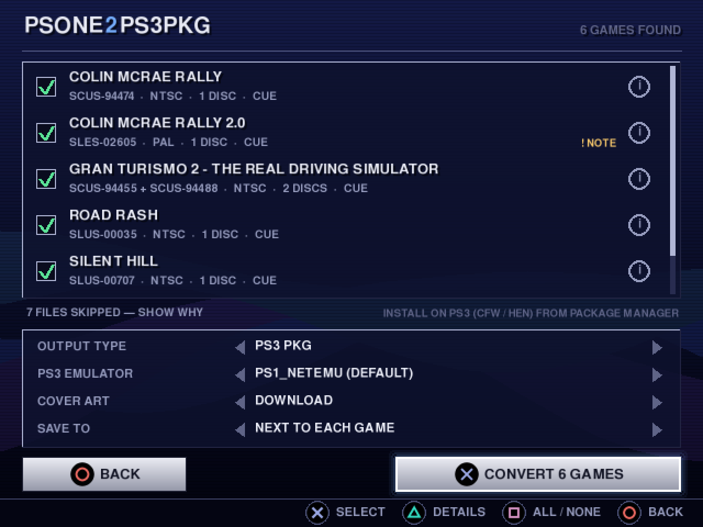
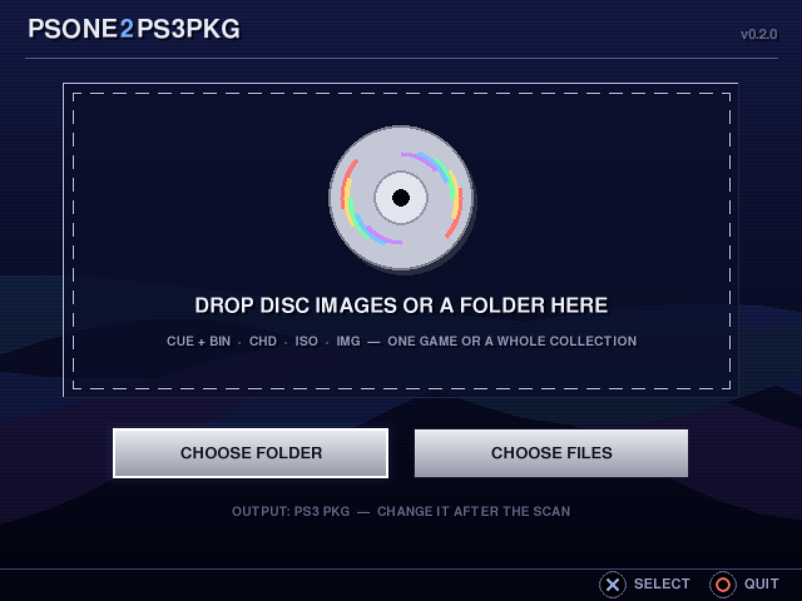
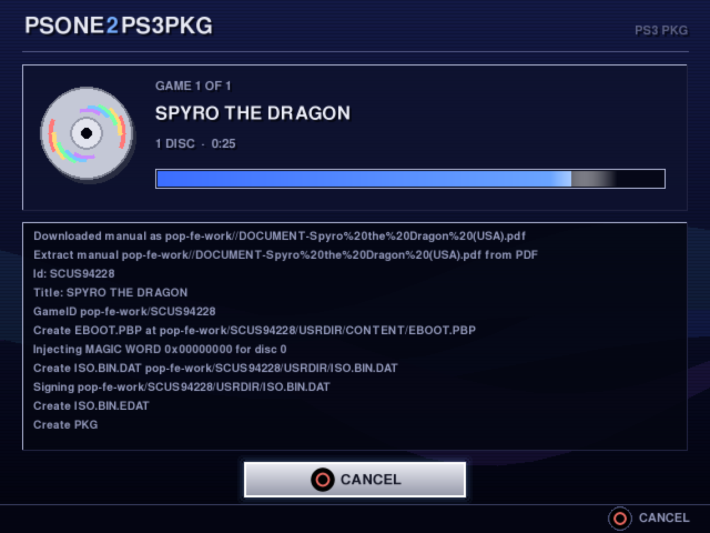
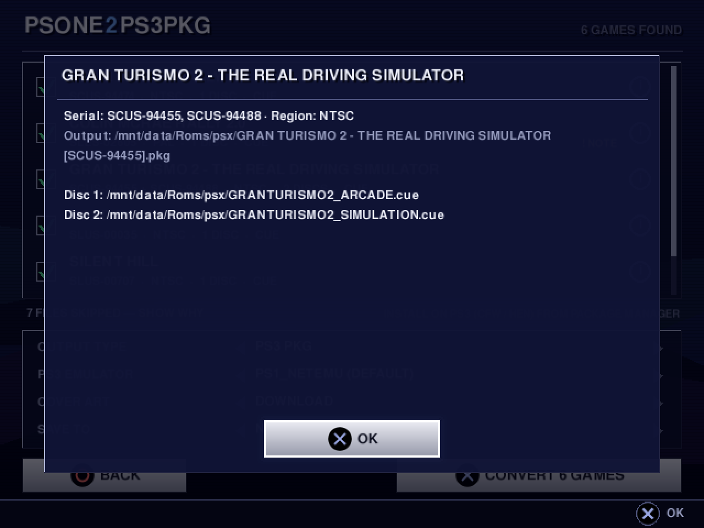
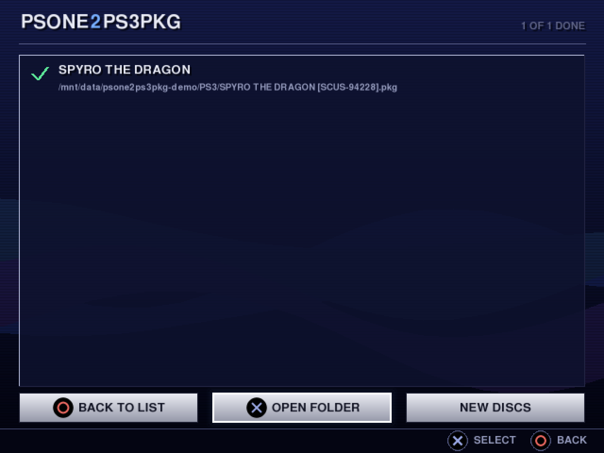

# psone2ps3pkg

A small drag-and-drop desktop app that turns **PlayStation 1** disc images into
packages that other PlayStation consoles can run:

| Output | Runs on | You get |
|--------|---------|---------|
| **PS3 PKG** | PS3 with CFW or HEN | `<Title> [SERIAL].pkg`, install from Package Manager |
| **PSP / Vita EBOOT** | PSP (CFW), PS Vita (Adrenaline) | `PSP/GAME/<SERIAL>/EBOOT.PBP` |
| **PS2 POPStarter** | PS2 with POPStarter | `POPS/<ID>.<TITLE>.VCD` + cover art in `ART/` |

Drop one disc, one game folder or a whole ROM collection on the window. The app
finds every PS1 game, groups multi-disc games, skips duplicates and things it
cannot use (and says why), and lets you pick what to build.



| | |
|---|---|
|  |  |
|  |  |

The conversion engine is [pop-fe](https://github.com/sahlberg/pop-fe), bundled in
`vendor/pop-fe` (no download of the engine at run time).

## Get it

Download `psone2ps3pkg-<version>-x86_64.AppImage` from the
[latest release](../../releases/latest). It is one file with everything inside
(Python, pop-fe, the PKG signer); it runs on x86-64 Linux distributions with
glibc 2.31 or newer (Ubuntu 20.04+, Debian 11+, Fedora 32+, Arch, openSUSE, Mint…).

```sh
chmod +x psone2ps3pkg-*-x86_64.AppImage
./psone2ps3pkg-*-x86_64.AppImage              # or double-click it
./psone2ps3pkg-*-x86_64.AppImage --install    # optional: add it to the app menu
```

`--install` copies the AppImage to `~/.local/bin/psone2ps3pkg` and adds a menu
entry and icon; `--uninstall` removes them. If your system has no FUSE, run with
`--appimage-extract-and-run` or set `APPIMAGE_EXTRACT_AND_RUN=1`.

Optional: `chdman` (package `mame-tools`) for `.chd` images, and an internet
connection for cover art. Without internet you still get a working package, only
without artwork.

## Use

1. Drop disc images or a folder on the window, or click **CHOOSE FOLDER** /
   **CHOOSE FILES**.
2. Check the games you want. **i** shows the serial, disc files and notes for a game.
3. Pick the **output type**, the PS3 emulator, cover art and where to save.
4. Press **CONVERT**.

By default each package goes next to its game. **SAVE TO** picks one folder for all.

Controls work with mouse, keyboard or a game pad:

| | Keyboard | Pad |
|---|---|---|
| move / change option | arrows | d-pad |
| select | Enter, Space | ✕ |
| back / cancel | Esc, Backspace | ○ |
| game details | I | △ |
| select all / none | A | □ |

### Accepted input

| Input | Notes |
|-------|-------|
| `.cue` + `.bin`/`.img` | best; CD-audio tracks are kept. Cue sheets with Windows paths or wrong letter case are fixed automatically |
| `.chd` | needs `chdman` |
| bare `.bin` / `.img` | if a `.cue` next to it lists it, the `.cue` is used; else CD audio is lost |
| raw `.iso` (2352-byte sectors) | accepted; a data-only 2048-byte `.iso` is refused (no audio, no XA) |
| `.7z`, `.rar`, `.zip` | listed as skipped; extract them first |

Multi-disc games (by pop-fe's game database, or by `(Disc N)` in the file names)
become **one** package with disc swapping. PS2 discs are recognised and skipped.

### Without a window

```sh
psone2ps3pkg --list  ~/Games/PS1                      # show what it finds
psone2ps3pkg --headless -t ps3 ~/Games/PS1            # build all, ask once
psone2ps3pkg --headless -y -t psp -o /media/MS0 game.cue
psone2ps3pkg --check                                  # verify the engine
```

`-t` is `ps3`, `psp` or `ps2`; `--newemu` picks PS3 `ps1_newemu`; `--no-art`
skips the cover-art download.

## Installing the result

**PS3** (CFW such as Evilnat, or HEN): copy the `.pkg` to a FAT32 USB stick or
FTP it to `/dev_hdd0/packages/`, then XMB → **Package Manager → Install Package
Files**. No RAP is needed. Content ID is `UP9000-<SERIAL>_00-0000000000000001`.
`ps1_netemu` is the default emulator; try `ps1_newemu` if a game misbehaves.

**PSP / PS Vita**: copy the `PSP` folder to the root of the memory stick
(PSP), or to `ux0:pspemu/` (Vita with Adrenaline).

**PS2**: copy `POPS` and `ART` to the root of the USB drive or HDD partition
POPStarter / OPL uses. POPStarter itself (`POPSTARTER.ELF`, `POPS_IOX.PAK`) is
not included.

**Why no PS4?** PS4 packages need Sony's own packaging tool from the PS4 SDK. No
open-source tool can build them, so this app cannot offer them.

## Notes

- **CD audio** is kept as raw tracks (`--whole-disk` on PS3, `--psp-use-cdda` on
  PSP), so no ATRAC3 encoder is needed. Packages are about the size of the disc.
- **LibCrypt (PAL games).** The executable patch is skipped (`--no-libcrypt`);
  pop-fe still writes the subchannel protection data from its database, which
  `ps1_netemu` uses. If a PAL title stops at a known LibCrypt check, that is why.
- The first conversion copies the engine to `~/.local/share/psone2ps3pkg/engine/`.
  Settings live in `~/.config/psone2ps3pkg/settings.json`.

## Support psone2ps3pkg

If this saved you some time, you can [buy me a coffee on Ko-fi](https://ko-fi.com/asnidev).
A star on GitHub helps too, and bug reports go to the [issues](../../issues).

## Development

```sh
python3 -m venv .venv && . .venv/bin/activate
pip install -e ".[dev]"
psone2ps3pkg                  # run the app from source
pytest                        # 34 tests; the GUI ones run on SDL's dummy driver
```

From source you also need a C compiler and Python headers once, to build pop-fe's
`pkgcrypt` extension (`gcc python3-devel` on Fedora, `build-essential python3-dev`
on Debian/Ubuntu).

```
src/psone2ps3pkg/
  disc.py      read one disc: ISO9660 + SYSTEM.CNF -> serial, region; cue parsing
  library.py   find all games below the dropped paths, de-duplicate, group discs
  convert.py   run pop-fe for PS3 / PSP / PS2, check and clean up the output
  engine.py    stage the bundled pop-fe, build pkgcrypt, game database
  gui/         pygame window (app.py), PSX-style drawing (theme.py), dialogs
  desktop.py   menu entry, --install / --uninstall
  cli.py       arguments, --headless, --check
vendor/pop-fe/ bundled engine (see vendor/VENDOR.md for upstream revisions)
scripts/       build_release.sh (AppImage), screenshots.py, make_icon.py
```

`scripts/build_release.sh` builds the AppImage: PyInstaller one-folder bundle +
`appimagetool`. pop-fe calls a bare `python3` for its helper scripts; in the
bundle there is none, so `engine.py` puts a `python3` shim on `PATH` that runs the
script inside the app through a hidden `--internal-exec` flag. The release
workflow builds on Debian 11 for glibc 2.31 compatibility and attaches the
AppImage and `SHA256SUMS` to each `v*` tag.

`scripts/screenshots.py ROMS OUT --convert N --build-dir DIR` drives the real app
off-screen, converts game N for real and saves the screenshots above.

## License

MIT for this app (see `LICENSE`). The bundled pop-fe and its parts keep their own
licenses (LGPL-2.1 and others, see `NOTICE`). The face-button symbols are drawn
by the app; "PlayStation", "PS3", "PSP" and "PS Vita" are trademarks of Sony
Interactive Entertainment, and this project is not affiliated with Sony.
